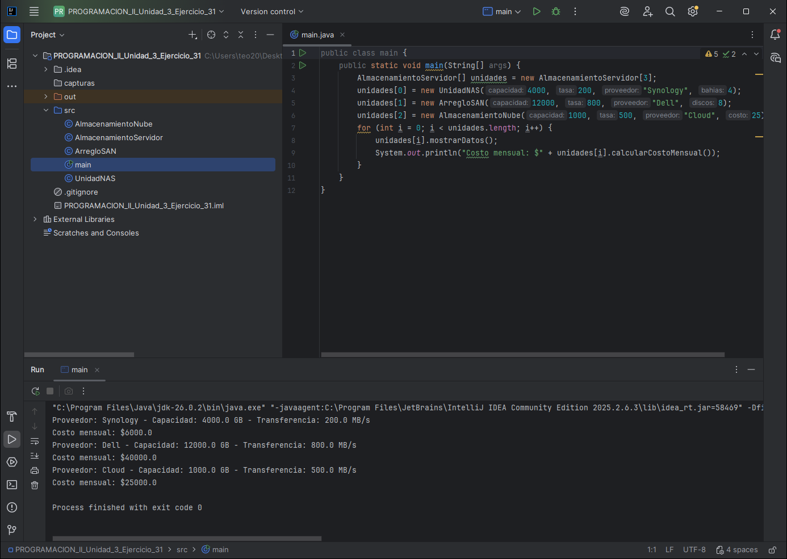

# PROGRAMACIÓN II — Unidad 3, Ejercicio 31: Jerarquía de Dispositivos de Almacenamiento en Red

Trabajo práctico de Programación II. Este repositorio contiene la resolución en Java del ejercicio 31 de la Unidad 3.

## Consigna

#### Contexto

En la arquitectura de servidores de una compañía tecnológica, las unidades de almacenamiento comparten propiedades físicas y lógicas generales como la capacidad total y la velocidad de transferencia. No obstante, los discos de red (NAS), las matrices de discos empresariales (SAN) y las unidades de almacenamiento en la nube poseen protocolos de acceso y costos de mantenimiento muy diferenciados que justifican una estructura jerárquica.

#### Consigna

Construir una jerarquía de clases orientada a objetos en Java que modele un dispositivo de almacenamiento genérico y sus respectivas especializaciones para arquitecturas de servidores.

#### Desarrollo requerido

- Crear la clase base AlmacenamientoServidor con atributos protegidos como capacidadGb, tasaTransferenciaMb y proveedor.
- Desarrollar clases hijas como UnidadNAS, ArregloSAN y AlmacenamientoNube que extiendan de la clase base añadiendo atributos propios (como número de bahías de discos o costo por giga byte mensual).
- Implementar el uso de la palabra clave super en los constructores de las subclases para inicializar los atributos heredados correctamente.
- En el método main, crear instancias de los distintos tipos de almacenamiento, invocar sus métodos de cálculo de costo o rendimiento y mostrar los detalles por consola.

## Estructura del repositorio

```
PROGRAMACION_II_Unidad_3_Ejercicio_31/
├── README.md
├── capturas/
│   └── consola.png
└── src/
    ├── AlmacenamientoNube.java
    ├── AlmacenamientoServidor.java
    ├── ArregloSAN.java
    ├── main.java   # clase con el método main
    └── UnidadNAS.java
```

## Funcionamiento y lógica

El ejercicio aplica **herencia y polimorfismo** para calcular el costo mensual de distintas soluciones de almacenamiento.

### `AlmacenamientoServidor` (clase base)

Tiene `capacidadGb`, `tasaTransferenciaMb` y `proveedor` (`protected`).

- **`mostrarDatos()`:** imprime esos datos.
- **`calcularCostoMensual()`:** en la clase base devuelve 0.

### Subclases

Cada una sobrescribe `calcularCostoMensual()` con su propio criterio:

- **`UnidadNAS`:** $1500 por cada bahía.
- **`ArregloSAN`:** $5000 por cada disco.
- **`AlmacenamientoNube`:** capacidad en GB × costo por GB.

### `main`

Crea un arreglo `AlmacenamientoServidor[]` con tres unidades, y para cada una muestra los datos y el costo mensual:

- NAS Synology de 4 bahías → **$6000**.
- SAN Dell de 8 discos → **$40000**.
- Nube de 1000 GB a $25 por GB → **$25000**.

## Ejecución

Captura de la consola de IntelliJ IDEA ejecutando el programa:



Salida obtenida:

```
Proveedor: Synology - Capacidad: 4000.0 GB - Transferencia: 200.0 MB/s
Costo mensual: $6000.0
Proveedor: Dell - Capacidad: 12000.0 GB - Transferencia: 800.0 MB/s
Costo mensual: $40000.0
Proveedor: Cloud - Capacidad: 1000.0 GB - Transferencia: 500.0 MB/s
Costo mensual: $25000.0
```
